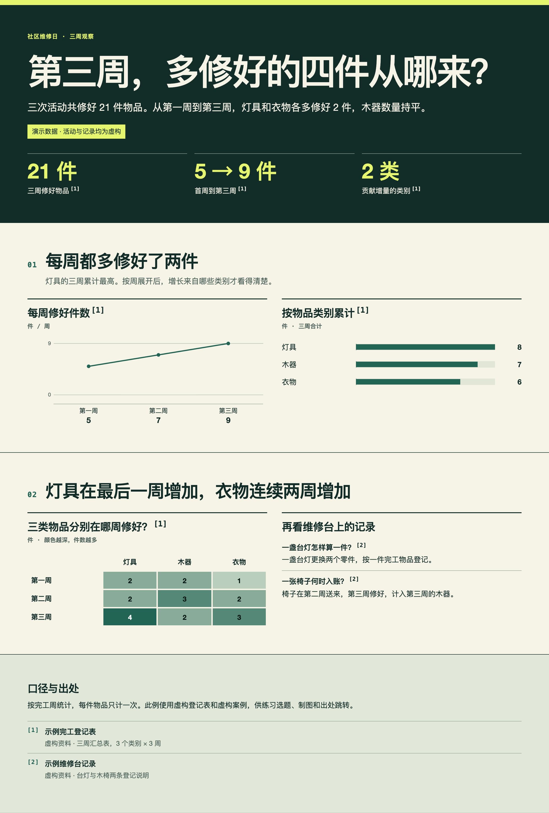

# 数据长图 · data-infographic

用 Codex 把表格、报告或视频转录合集做成竖版信息图，适合大会演示和手机阅读。在 HTML 成品里，读者可以点击图表旁的编号，查看数字来自哪张表、哪一页报告或哪段视频。

## 安装

首次安装时，在 macOS 或 Linux 上用有仓库读取权限的账号登录 GitHub CLI（`gh auth login`），再把仓库克隆到个人 Skill 目录。

```sh
skill_root="${CODEX_HOME:-$HOME/.codex}/skills"
mkdir -p "$skill_root"
gh repo clone guokaixin137-droid/data-infographic "$skill_root/data-infographic"
```

## 在 Codex 里开始一张图

在新对话里附上材料，说明受众和用途。例如，你可以这样发起一个项目。

> 用 `$data-infographic` 把这几年的大会转录做成一张竖版长图，给现场观众看。请给我一张高清 PNG 和一份可以点开出处的 HTML。

每个新项目先确认一次选题方式。若你已经在请求里说明了偏好，Codex 会沿着该方式继续。

| 选题方式 | 你会看到什么 |
| --- | --- |
| **直接生成** | Codex 阅读资料，挑出值得讲的发现，配上能解释它们的对比和案例，直接交付成图。 |
| **先看方向，我来选** | Codex 通常列出 3–5 个有材料支撑的方向，说明各自能回答什么、可以怎样画。你可以只选一部分，也可以自拟方向。选定后，Codex 会围绕它们补齐相关数据、趋势和案例。 |

例如，在第二种方式里，你可以回复「我选观众留存和发布节奏。请补上这两项的跨年变化，以及讲者提到的具体做法。」之后想增加篇幅、调整配色或换导出格式，都可以沿用已选主线。

使用 Clipto 分享链接时，可通过当前会话已连接的 Clipto 工具读取转录，也可以直接附上导出的转录文件。默认采用资料中可核验的信息。做演示时可以明确允许模拟数值，成品会在相应位置标注。

## 看一张成品

这张图使用虚构的「社区维修日」记录。第一周修好 5 件物品，第三周修好 9 件。折线展示总量变化，下面的矩阵解释多出来的 4 件来自哪里。点击预览可看原图。[查看示例数据](assets/example.json)

<a href="docs/repair-day.png"></a>

## 在本地复现示例

在仓库根目录运行以下命令，用 Python 3 生成 `poster.html`，双击即可离线阅读。

```sh
python3 scripts/render.py assets/example.json poster.html
```

导出 PNG 和 PDF 还需要 Node.js、Playwright（或 `playwright-core`）和 Chromium 系浏览器。首次配置导出环境时，可以在同一目录运行以下两行。

```sh
npm install --no-save --package-lock=false playwright
npx playwright install chromium
```

下面的命令会生成宽 2400 像素的 `poster.png` 和可放大阅读的单页矢量 `poster.pdf`。如果只需要一种格式，保留相应的输出文件名即可。

```sh
node scripts/export.cjs poster.html poster.png poster.pdf
```

要换成自己的数据，可以从示例 JSON 改起。图表类型、来源字段和浏览器路径设置见[模板与导出说明](references/rendering.md)。选题和核验流程见 [SKILL.md](SKILL.md)。
