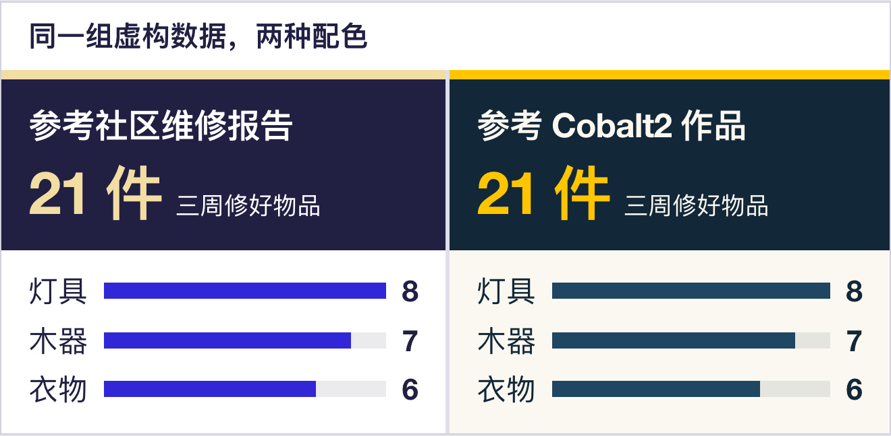

# 数据长图

这是一个在 Codex 对话里使用的小工具。把文章、访谈、读者来信或表格发给它，它会找出重点，做成一张竖版长图。读者先看关键发现，再往下看图表和原文例子。

## 拿到链接，怎么用？

**打开 Codex，把下面的话复制到对话里，附上你的资料，一起发送。**

```text
请安装并使用这个技能，把我附上的资料做成一张竖版信息图。
https://github.com/guokaixin137-droid/data-infographic
技能名是 data-infographic，放在仓库最外层。
```

Codex 会问你想让它直接做图，还是先给几个选题让你挑。想让它全程安排，就回复「你来定」。以后用时，只要附上新资料并说「用数据长图做图」。

分享给同事时，发这个 [GitHub 链接](https://github.com/guokaixin137-droid/data-infographic) 就行。仓库公开可读，做图用的材料发在各自的 Codex 对话里。

## 做出来是什么样？

[](docs/repair-day.png)

在这个虚构的「社区维修日」例子里，多修好的 4 件来自灯具和衣物，各多 2 件。木器数量持平。[看完整长图](docs/repair-day.png)

## 可以交给它哪些资料？

可以附文件、告诉 Codex 要读哪个文件夹，或贴一个它能打开的分享链接。比如，附上读者来信后，可以在对话里这样说。

> 用 `$data-infographic` 把这些读者来信做成一张长图，给编辑部开会用。最后给我一张能发到群里的图片。

一整年的来信也可以一起交。Codex 会分批读。统计“有多少封提到这件事”时，同一封信分成几段都只算一封。视频可以发文字稿。如果 Codex 已连接 Clipto，也可以直接贴 Clipto 的分享链接。

## 我需要自己选题吗？

每个新项目开始时，Codex 会先问你想怎么定内容。如果第一句话里已经选好了，它就按你的选择继续。

- **想直接拿到图**，回复「你来定」。Codex 会读材料、选重点，再把图做好。
- **想自己拿主意**，回复「先给我几个方向」。Codex 会列出材料能支持的选题。你可以只挑一个、选几个，也可以提出自己的想法。接下来它会围绕你选的内容补上对比、原文和例子。


## 可以用我喜欢的颜色吗？

可以直接说「用我们的品牌蓝」，也可以发一张参考图。给出博主主页，Codex 会从这位博主的公开作品里找常用色。只给主题，它就上网对照同类报告和信息图。你也可以要求离线制作。



这两张小图用的是同一组虚构数字，方便比较颜色。成品页尾会列出配色参考。[社区维修报告，第 12–13 页](https://openrepair.org/wp-content/uploads/2024/10/ORA-report-2024-The-rise-of-community-repair.pdf#page=12) · [Wes Bos 的 Cobalt2 色表](https://github.com/wesbos/cobalt2-vscode#colours)

## 做好后，应该用哪个文件？

| 你想做什么 | 让 Codex 给你 |
| --- | --- |
| 发到群里，或插入幻灯片 | **PNG 图片**，打开就能看整张长图。 |
| 一边阅读，一边查数字和引文来自哪里 | **HTML 网页**，用浏览器打开，点编号就能跳到出处说明。 |
| 打印，或放大查看细小的图表 | **PDF 文档**，整张图在一页内，放大后文字和线条依然清晰。 |


默认使用能在材料中核实的内容。做概念演示时，可以说明「允许用模拟数字，请在图上标明」。拿到成品后也可以接着说「把第二部分加长」或「再给我一份 PDF」。

<details>
<summary>习惯用终端？展开手动安装和导出示例</summary>

如果使用 Codex 自带的 `skill-installer`，给它仓库链接，并指定 `--path . --name data-infographic`。其中 `.` 表示技能在仓库最外层。

在装有 Git 的 macOS 或 Linux 上，首次安装可以运行以下命令。

```sh
skill_root="${CODEX_HOME:-$HOME/.codex}/skills"
mkdir -p "$skill_root"
git clone https://github.com/guokaixin137-droid/data-infographic.git "$skill_root/data-infographic"
cd "$skill_root/data-infographic"
```

在仓库目录里，用 Python 3 生成可以离线打开的示例网页。

```sh
python3 scripts/render.py assets/example.json poster.html
```

如需导出 PNG 和 PDF，还要有 Node.js、Playwright（或 `playwright-core`）以及 Chromium 系浏览器。首次配置可运行前两行，已有这些工具可以直接运行最后一行。

```sh
npm install --no-save --package-lock=false playwright
npx playwright install chromium
node scripts/export.cjs poster.html poster.png poster.pdf
```

模板默认导出宽 2400 像素的 PNG 和单页矢量 PDF。[示例数据](assets/example.json) · [模板与导出](references/rendering.md) · [大批量文本](references/large-text.md) · [联网取色](references/palette.md) · [完整技能说明](SKILL.md)

</details>
